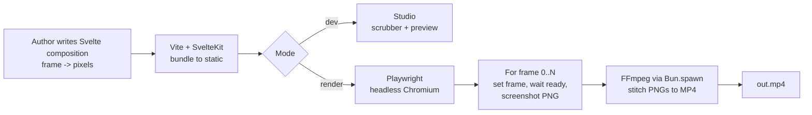

# svelte-remotion


[](https://opensource.org/licenses/MIT)
[](https://svelte.dev)
[](https://kit.svelte.dev)
[](https://bun.sh)
[](https://www.typescriptlang.org)
[](https://github.com/RichardLitt/standard-readme)
[](https://github.com/Michael-Obele/svelte-remotion)

Make videos programmatically with Svelte 5 — Remotion for Svelte, headless Chrome + FFmpeg.

Write a video as a Svelte component. The renderer screenshots every frame in headless Chromium and FFmpeg stitches them to MP4 — the same deterministic pipeline as Remotion, with no React and no virtual DOM tax. MIT licensed.

## Table of Contents

- [Background](#background)
- [Install](#install)
- [Usage](#usage)
- [Features](#features)
- [How it works](#how-it-works)
- [Tech Stack](#tech-stack)
- [Project Structure](#project-structure)
- [API](#api)
- [Contributing](#contributing)
- [License](#license)

## Background

Remotion proved that code is the best video editor: a React component as a function of `frame`, a headless browser that screenshots every frame, and FFmpeg that encodes to MP4. The pipeline is framework-agnostic — if it paints in a browser tab, it paints in a frame.

**svelte-remotion** keeps that pipeline and swaps the authoring layer to Svelte 5. Runes (`$state`, `$derived`, `$props`, snippets) map cleanly to time: `frame` is reactive state, every animation is a derived value, and the browser does not pay a virtual-DOM cost for 1,800 frames. SvelteKit + Vite replace Webpack, Playwright replaces Puppeteer, and `Bun.spawn` drives FFmpeg.

Why now: Svelte 5 runes and SvelteKit 2 are stable on Vite 6, agents write Svelte 5 fluently, and an MIT alternative has a clear incentive versus Remotion's company license. See [`AGENTS.md`](AGENTS.md) for the full spec index and build plan.

## Install

**Prerequisites**

- Node 20+ (Node 22 for SvelteKit 3 / Vite 8) · [Bun](https://bun.sh) · [FFmpeg](https://ffmpeg.org) · Chromium via Playwright

**Scaffold a new project**

```bash
bunx sv create my-video --template minimal
cd my-video
bun install
bunx playwright install chromium
```

**Add svelte-remotion** (when published)

```bash
bun add svelte-remotion
# or
npm install svelte-remotion
```

**System dependencies**

```bash
# FFmpeg — macOS
brew install ffmpeg
# FFmpeg — Ubuntu/Debian
sudo apt update && sudo apt install ffmpeg
# Verify
ffmpeg -version
npx playwright --version
```

> **Status: planning.** The package is not yet published. Follow the milestones in [`AGENTS.md`](AGENTS.md) — M0 proves determinism, M2 ships `svelte-remotion render`.

## Usage

### 1. Write a composition

```html
<!-- compositions/hello-world/HelloWorld.svelte -->
<script lang="ts">
  import { getMotionContext } from "$lib/motion/context.svelte";
  import { interpolate } from "$lib/math/interpolate";

  const motion = getMotionContext();
  let opacity = $derived(interpolate(motion.frame, [0, 30], [0, 1]));
  let scale = $derived(interpolate(motion.frame, [0, 30], [0.8, 1]));
</script>

<div
  style:opacity
  style:transform="scale({scale})"
  style:width="{motion.width}px"
  style:height="{motion.height}px"
>
  Hello at frame {motion.frame}
</div>
```

```ts
// compositions/hello-world/index.ts
import { defineComposition } from "$lib/motion/composition";
import HelloWorld from "./HelloWorld.svelte";

export default defineComposition({
  id: "hello-world",
  component: HelloWorld,
  width: 1920,
  height: 1080,
  fps: 30,
  durationInFrames: 90,
});
```

### 2. Timeline primitives

```html
<script lang="ts">
  import Sequence from "$lib/timeline/Sequence.svelte";
  import Series from "$lib/timeline/Series.svelte";
</script>

<!-- Offset time -->
<Sequence from="{30}" durationInFrames="{60}">
  {#snippet children({ frame })}
  <div>Local frame {frame} — global {frame + 30}</div>
  {/snippet}
</Sequence>

<!-- Back-to-back -->
<Series>
  {#snippet children()}
  <Sequence durationInFrames="{30}"
    >{#snippet children({ frame })}<title {frame} />{/snippet}</Sequence
  >
  <Sequence durationInFrames="{60}"
    >{#snippet children({ frame })}
    <main {frame} />
    {/snippet}</Sequence
  >
  {/snippet}
</Series>
```

### 3. Preview and render

```bash
# Studio — scrub, timeline, live preview
bun run dev

# Headless render to MP4
bunx svelte-remotion render hello-world --out out.mp4

# With props
bunx svelte-remotion render hello-world --props '{"title":"Hello"}' --out out.mp4
```

**Determinism rule:** compositions must be pure functions of `frame`. No `Math.random()`, `Date.now()`, or wall-clock reads — the renderer screenshots frames concurrently and out of order.

## Features

| Feature                  | Detail                                                                                                           |
| ------------------------ | ---------------------------------------------------------------------------------------------------------------- |
| **Frame runtime**        | `MotionContext` via `setContext`/`getContext` + `$state` — `frame`, `fps`, `width`, `height`, `durationInFrames` |
| **Timeline**             | `Sequence`, `Series`, `Loop`, `Freeze` as Svelte 5 snippets with frame-offset math                               |
| **Math helpers**         | `interpolate`, `interpolateColors`, `spring`, `measureSpring`, `Easing` — pure TS, ported from Remotion          |
| **Composition registry** | `defineComposition` + `import.meta.glob` discovery                                                               |
| **Player**               | Svelte `Player` with `requestAnimationFrame`, scrubbing, and controls                                            |
| **Renderer CLI**         | `svelte-remotion render` — serves build, drives Playwright, streams to FFmpeg                                    |
| **Studio**               | SvelteKit app — composition picker, preview, scrubber, timeline                                                  |
| **Assets**               | `delayRender`/`continueRender` + `ready` + `staticFile` + `document.fonts.ready` gate                            |

## How it works



1. **Bundle** — Vite + `vite-plugin-svelte` + `adapter-static` to `build/`.
2. **Serve** — `vite preview` on a dedicated port (no HMR).
3. **Capture** — `page.goto('...?composition=id&frame=N')` → wait `svelteMotion_ready()` + `document.fonts.ready` + `networkidle` → `page.screenshot({ clip })`.
4. **Encode** — `Bun.spawn` FFmpeg: `ffmpeg -framerate 30 -i frame%04d.png -c:v libx264 -pix_fmt yuv420p out.mp4`.

Concurrency runs multiple Chromium contexts; frames stream to FFmpeg via stdin for long videos.

## Tech Stack

| Layer      | Choice                              | Why                                                          |
| ---------- | ----------------------------------- | ------------------------------------------------------------ |
| UI         | Svelte 5 runes, SvelteKit 2, Vite 6 | Runes model time cleanly; SvelteKit gives routing + adapters |
| Language   | TypeScript 5                        | Types for compositions and props                             |
| Runtime    | Bun                                 | `Bun.spawn` for FFmpeg, fast installs                        |
| Browser    | Playwright (Chromium)               | Stable screenshot API, multi-browser future                  |
| Encoding   | FFmpeg (H.264)                      | Industry standard, CRF + keyframe control                    |
| Validation | Valibot                             | Tree-shakable, SvelteKit remote-function friendly            |
| Styling    | Tailwind CSS                        | Utility-first, Vite-native                                   |

## Project Structure

```
svelte-remotion/
├── assets/
│   └── banner.svg
├── src/
│   ├── lib/
│   │   ├── motion/       # context.svelte.ts, config.ts, composition.ts, ready.ts
│   │   ├── timeline/     # Sequence.svelte, Series.svelte, Loop.svelte, Freeze.svelte
│   │   ├── math/         # interpolate.ts, spring.ts, easing.ts (pure TS)
│   │   ├── player/       # Player.svelte, PlayerControls.svelte
│   │   ├── renderer/     # browser.ts, ffmpeg.ts, render.ts, assets.ts
│   │   └── studio/       # Timeline.svelte, Scrubber.svelte, Preview.svelte
│   ├── routes/           # SvelteKit Studio routes
│   └── app.html
├── compositions/         # user videos — each a .svelte file + defineComposition
├── AGENTS.md             # agent & contributor guide (indexes the internal spec)
└── README.md             # you are here
```

> Internal spec lives out of tree (gitignored). See [`AGENTS.md`](AGENTS.md) for the full document map and milestone gates.

## API

| Export                                  | Kind      | Description                                                                                 |
| --------------------------------------- | --------- | ------------------------------------------------------------------------------------------- |
| `getMotionContext` / `setMotionContext` | function  | Access the reactive `MotionContext` (`frame`, `fps`, `width`, `height`)                     |
| `useCurrentFrame()`                     | function  | Returns current `frame` as `number`                                                         |
| `useVideoConfig()`                      | function  | Returns `{ fps, width, height, durationInFrames }`                                          |
| `defineComposition`                     | function  | Register a video (`id`, `component`, `width`, `height`, `fps`, `durationInFrames`, `props`) |
| `Sequence`                              | component | Offsets time: `from`, `durationInFrames`, snippet `children({ frame })`                     |
| `Series`                                | component | Lays out children back-to-back, computes `from` cumulatively                                |
| `Loop` / `Freeze`                       | component | Repeat (`frame % duration`) / pin to fixed frame                                            |
| `interpolate` / `interpolateColors`     | function  | Pure math — numeric, string, color interpolation with easing + extrapolate                  |
| `spring` / `measureSpring`              | function  | Physics-based animation, duration measurement                                               |
| `delayRender` / `continueRender`        | function  | Block screenshots until async work (fonts, data) resolves; `ready` is the shorthand         |
| `Player`                                | component | Browser player at `fps` with controls and scrubbing                                         |
| `svelte-remotion render`                | CLI       | `render <composition> --out <file> [--props JSON] [--concurrency N]`                        |

Full React → Svelte translation table lives in the internal spec (see `AGENTS.md`).

## Contributing

PRs and issues are welcome. This is a Standard Readme project — see the [spec](https://github.com/RichardLitt/standard-readme/blob/main/spec.md).

- **Questions?** Open a [GitHub Issue](https://github.com/Michael-Obele/svelte-remotion/issues) or [Discussion](https://github.com/Michael-Obele/svelte-remotion/discussions).
- **PRs accepted.** Please lint (`bun run lint`) and test (`bun test`) before submitting. Keep compositions deterministic and add a test for new math helpers.
- **Style:** Svelte 5 runes only, TypeScript strict, Valibot for props, `Bun.spawn` for subprocesses.

See [`AGENTS.md`](AGENTS.md) for architecture, decisions, and milestone gates before starting work.

## License

[MIT](LICENSE) © Michael Obele. Remotion is a separate project under its own [license](https://github.com/remotion-dev/remotion/blob/main/LICENSE.md).
