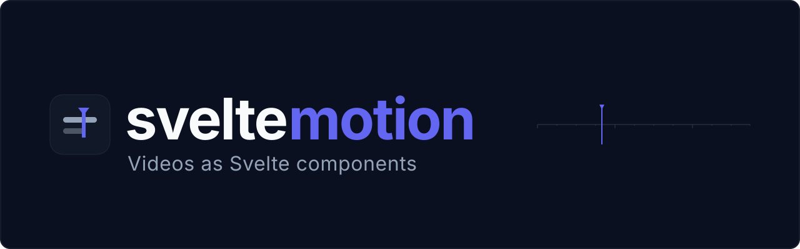

# svelte-motion



[](https://opensource.org/licenses/MIT)
[](https://svelte.dev)
[](https://svelte.dev/docs/kit)
[](https://viteplus.dev)
[](https://bun.sh)
[](https://www.typescriptlang.org)
[](https://github.com/Michael-Obele/svelte-motion)

Make videos programmatically with Svelte 5. Remotion's pipeline, no React.

A video is a Svelte component. The frame is reactive state. The renderer sets each frame in headless Chromium, screenshots it, and FFmpeg stitches the frames into an MP4. Same shape as Remotion, MIT licensed, with no virtual DOM in the loop.

## Table of Contents

- [Background](#background)
- [Status](#status)
- [Install](#install)
- [Usage](#usage)
- [How it works](#how-it-works)
- [Project structure](#project-structure)
- [Gates](#gates)
- [Contributing](#contributing)
- [License](#license)

## Background

Remotion showed that code is a good video editor: a component as a function of the current frame, a headless browser that screenshots every frame, and FFmpeg that encodes the result. None of that depends on React. The browser only has to paint.

svelte-motion keeps the pipeline and swaps the authoring layer to Svelte 5 runes. `frame` is `$state`, every animation is `$derived`, and a frame is a pure function of its number, so the same frame renders the same bytes on every run.

## Status

Working at version 0.1, not yet published to npm. Every workspace member builds, and the gates below run in this repo.

What works today:

- Frame runtime, timeline primitives, composition registry, and math helpers ported from Remotion 4.0.538 with parity tests
- Player with playback, seek, and loop
- Renderer that produces byte-identical MP4s across runs
- CLI with `render` and `list`
- Studio with a composition picker, preview, scrubber, and timeline bar

Known limits:

- Video only. Audio components exist for preview, but audio is not muxed into the MP4 yet.
- The Studio timeline shows one track with a playhead. Sequence nesting bars need a timeline registry that does not exist yet.
- `interpolate` does not implement Remotion's `output` and `outputType` CSS sugar (`perceptual-scale`, `font-weight`). Passing either option throws.
- One browser page per concurrency slot, default concurrency 1.

## Install

Prerequisites: [Bun](https://bun.sh) 1.4+, [FFmpeg](https://ffmpeg.org) on `PATH`, Chromium through Playwright.

```bash
# FFmpeg
brew install ffmpeg        # macOS
sudo apt install ffmpeg    # Ubuntu / Debian

# Chromium for Playwright
bunx playwright install chromium
```

The packages are not published yet. To work from this repo:

```bash
bun install
vp run studio#build
bun packages/cli/src/index.ts render hello-world --out out/video.mp4 --build apps/studio/build
```

## Usage

### 1. Write a composition

```html
<!-- src/compositions/hello-world/HelloWorld.svelte -->
<script lang="ts">
  import { interpolate, spring, getMotionContext } from "@svelte-motion/core";

  const motion = getMotionContext();
  const frame = $derived(motion.frame);
  const opacity = $derived(interpolate(frame, [0, 30], [0, 1], { extrapolateRight: "clamp" }));
  const rise = $derived(spring({ frame, fps: 30, config: { damping: 200 } }));
</script>

<div style:opacity style:transform="translateY({(1 - rise) * 40}px)">Hello at frame {frame}</div>
```

```ts
// src/compositions/hello-world/index.ts
import { defineComposition } from "@svelte-motion/core";
import HelloWorld from "./HelloWorld.svelte";

export default defineComposition({
  id: "hello-world",
  component: HelloWorld,
  width: 1920,
  height: 1080,
  fps: 30,
  durationInFrames: 90,
});
```

### 2. Time it with the timeline

```html
<Sequence from="{30}" durationInFrames="{60}">
  {#snippet children({ frame })}
  <p>Local frame {frame}</p>
  {/snippet}
</Sequence>
```

`Sequence`, `Series`, `Loop`, `Freeze`, `AbsoluteFill`, and `Clipper` are exported from `@svelte-motion/core`.

### 3. Preview and render

```bash
# Gallery + Studio: picker, preview, scrubber, timeline
bun run dev

# CLI: list compositions, then render one
bun packages/cli/src/index.ts list --build examples/build
bun packages/cli/src/index.ts render title-card --out out/video.mp4 --build examples/build
```

`bun run dev` opens the examples app. `bun run dev:studio` opens the fixture harness —
the compositions the determinism and parity gates render, kept separate so that editing an
example cannot break a gate.

Full API references live in the package READMEs: [core](packages/core/README.md), [renderer](packages/renderer/README.md), [cli](packages/cli/README.md), [studio](apps/studio/README.md).

## Examples

Seven runnable compositions live in [`examples/`](examples/README.md). Four use scoped
CSS, three use Tailwind, and together they cover every timeline primitive:

- `title-card`: spring entrance, a rule that draws, staged timing with `Sequence`
- `lower-third`: a graphic sliding in and out inside one `Sequence`
- `image-gallery`: three images cross-fading with `prefetch` and a slow scale
- `data-chart`: bars from a JSON file fetched under `delayRender`, with a valibot schema
- `stat-grid` (Tailwind): cards on a grid, staggered springs, numbers that count up
- `quote-series` (Tailwind): `Series` stepping through a quote, one line at a time
- `loop-ticker` (Tailwind): `Loop` driving an endless ticker with no timer

Run everything from the repository root. The examples live in their own SvelteKit app, which
installs `@svelte-motion/core` from the package — the same setup you would have after
`bun add @svelte-motion/core`:

```bash
# Gallery + Studio for the examples (builds core first, since the app uses its dist)
bun run dev:examples

# Or render one to a file
bun run build:examples
bun packages/cli/src/index.ts render stat-grid --out out/stat-grid.mp4 --build examples/build
```

## How it works

1. Vite builds the Svelte app to static files.
2. The renderer serves that build with `Bun.serve` and opens `/render?composition=<id>&frame=<n>` in headless Chromium.
3. For each frame it sets the frame through `window.svelteMotion_setFrame(n)` and waits for the paint.
4. Playwright screenshots the frame as a PNG.
5. The PNGs stream into FFmpeg over `image2pipe` and come out as an MP4.

## Project structure

```
packages/core       @svelte-motion/core      browser runtime: frame state, timeline, math, player
packages/studio-ui  @svelte-motion/studio-ui picker, preview, scrubber, timeline, /render + /player hosts
packages/renderer   @svelte-motion/renderer  node only: serve, capture, encode
packages/cli        @svelte-motion/cli       render and list commands
apps/studio         authoring host for the studio's own fixtures + the render gates
apps/web            landing page
examples            a normal SvelteKit app: 7 compositions, a gallery, and the render hosts
tools/spike         determinism and parity gates
```

## Gates

Determinism is a test here, not a promise. Run these from the repository root:

```bash
vp check                                     # fmt, lint, typecheck
vp run -r test                               # unit tests, every member
bun run tools/spike/verify-determinism.ts    # same frames, same MP4 bytes
bun run tools/spike/verify-player-parity.ts  # player frame equals rendered frame
```

The end-to-end renders are opt-in because they take a few minutes and need a studio
build. Each runs inside its package, so `SM_E2E=1` is not swallowed by the task cache:

```bash
vp run studio#build
cd packages/renderer && SM_E2E=1 vp test    # render, determinism, parity, examples
cd ../cli && SM_E2E=1 vp test               # CLI commands end to end
cd ../..
```

## Contributing

Read [AGENTS.md](AGENTS.md). It lists the settled stack, the workspace commands, and the constraints that keep the pixel gates green. Keep `plan/` out of commits.

## License

MIT.
